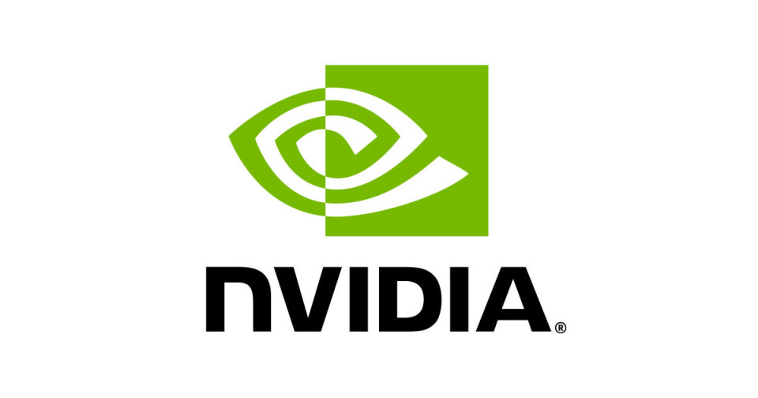

<p align="center">
  <a href="https://jinawinwin.github.io/SEC_NVIDIA/"></a>
</p>
<p align="center">
  <a href="https://jinawinwin.github.io/SEC_NVIDIA/"></a>
</p>

# SEC_NVIDIA — NVIDIA SEC 재무 분석 대시보드

SEC EDGAR의 XBRL 공시 데이터(10-K / 10-Q)를 크롤링해 NVIDIA의 **연간 · 반기 · 분기** 재무 데이터를 정리하고,
분석 결과를 GitHub Pages 대시보드로 배포합니다. 데이터는 **매월 1일과 5일** GitHub Actions가 자동으로 갱신합니다.

**대시보드:** https://jinawinwin.github.io/SEC_NVIDIA/

## 대시보드 구성

| 영역 | 내용 |
|---|---|
| 상단 KPI | 최근 분기·연간 매출, 순이익, 매출총이익률, 잉여현금흐름, 희석 EPS + 자동 생성 인사이트 |
| Figures | 연간 매출·순이익 · 분기 매출(YoY) · 수익성(마진) 추이 · 손익 Waterfall · 반기(H1/H2) 비교 · 현금 창출력 · 재무상태 구조 · 글로벌 피어 비교 |
| Tables | **연간(Annual) / 반기(Half-year) / 분기(Quarterly)** 3개 테이블 — 손익계산서·현금흐름표·재무상태표·주요 비율 |
| Peer Firms | 글로벌 피어 12개사 비교 테이블 (대시보드 최하단) |
| 플로팅 내보내기 | **PDF** — 대시보드 화면을 PDF로 저장 · **Excel** — 연간/반기/분기(+피어) 기간을 선택해 .xlsx 다운로드 |

## 최근 주요 수치

<!-- KEYFIGURES:START -->
| 구분 | 기간 | 매출 (USD M) | YoY | 매출총이익률 | 영업이익률 | 순이익 (USD M) | 희석 EPS |
|---|---|---:|---:|---:|---:|---:|---:|
| 최근 회계연도 | FY2026 (~2026-01-25) | 215,938 | 65.5% | 71.1% | 60.4% | 120,067 | $4.90 |
| 최근 반기 | H1 FY2027 (~2026-07-26) | 177,837 | 95.8% | 75.0% | 65.9% | 118,010 | $4.85 |
| 최근 분기 | Q2 FY2027 (~2026-07-26) | 96,221 | 105.9% | 75.0% | 66.2% | 59,688 | $2.46 |

_자동 업데이트: 2026-10-25 15:53 UTC_
<!-- KEYFIGURES:END -->

## Global Peer Firms

<!-- PEERS:START -->
| # | 기업 | 국가 | 상장 | NVIDIA와의 관계 | FY 종료 | 매출 (USD M) | 영업이익률 | 순이익률 | R&D/매출 |
|---|---|---|---|---|---|---:|---:|---:|---:|
| 1 | **NVIDIA** | United States | NASDAQ: NVDA | Subject company — GPUs, AI accelerators, networking, CUDA | 2026-01-25 | 215,938 | 60.4% | 55.6% | 8.6% |
| 2 | Advanced Micro Devices | United States | NASDAQ: AMD | Direct rival — Instinct AI GPUs, Radeon gaming GPUs, EPYC CPUs | 2025-12-27 | 34,639 | 10.7% | 12.5% | 23.4% |
| 3 | Intel | United States | NASDAQ: INTC | Rival — Gaudi AI accelerators, Arc GPUs, x86 CPUs, foundry | 2025-12-27 | 52,853 | -4.2% | -0.5% | 26.1% |
| 4 | Broadcom | United States | NASDAQ: AVGO | Rival — custom AI ASICs (XPUs) & Ethernet AI networking | 2025-11-02 | 63,887 | 39.9% | 36.2% | 17.2% |
| 5 | Marvell Technology | United States | NASDAQ: MRVL | Rival — custom AI silicon, optical/electrical interconnect | 2026-01-31 | 8,195 | 16.1% | 32.6% | 25.3% |
| 6 | Qualcomm | United States | NASDAQ: QCOM | Rival — edge/on-device AI SoCs, data-center inference | 2025-09-28 | 44,284 | 27.9% | 12.5% | 20.4% |
| 7 | Micron Technology | United States | NASDAQ: MU | Supplier — HBM memory for AI GPUs | 2026-09-03 | 133,188 | 74.6% | 63.8% | 4.2% |
| 8 | Taiwan Semiconductor (TSMC) | Taiwan | NYSE: TSM / TWSE: 2330 | Supplier — leading-edge foundry & CoWoS packaging | 2024-12-31 | 88,268 | 45.7% | 40.0% | 7.1% |
| 9 | Arm Holdings | United Kingdom | NASDAQ: ARM | Ecosystem — CPU IP used in Grace / data-center CPUs | 2026-03-31 | 4,920 | 18.3% | 18.4% | 56.4% |
| 10 | Samsung Electronics | South Korea | KRX: 005930 | Supplier/rival — HBM & memory, foundry | SEC 미제출 | – | – | – | – |
| 11 | SK hynix | South Korea | KRX: 000660 | Supplier — primary HBM supplier for NVIDIA GPUs | SEC 미제출 | – | – | – | – |
| 12 | Cambricon Technologies | China | SSE: 688256 | Regional rival — AI accelerators for the China market | SEC 미제출 | – | – | – | – |
<!-- PEERS:END -->

> 재무 수치는 각 사 SEC 10-K / 20-F XBRL의 최근 회계연도 기준(USD). 회계연도 종료일이 서로 다르므로 비교 시 유의하세요.
> 삼성전자·SK하이닉스·캄브리콘은 SEC 공시 대상이 아니므로 재무 수치는 비워 두었습니다(DART·SSE 공시 참고).

## 데이터 파이프라인

```
SEC EDGAR API ──► scripts/fetch_sec.py ──► data/raw/*.json
                                              │
                    scripts/build_dataset.py ◄┘
                                              │
         ┌────────────────────────────────────┼─────────────────────────────┐
         ▼                                    ▼                             ▼
data/processed/*.csv          docs/data/dashboard.json (+CSV)        README.md 자동 블록
(annual / semiannual /         → GitHub Pages 대시보드               (주요 수치·피어 테이블)
 quarterly / peers)
```

- **출처:** `https://data.sec.gov/api/xbrl/companyfacts/CIK0001045810.json`, `https://data.sec.gov/submissions/CIK0001045810.json`
- **분기/반기 산출:** 직접 공시되지 않은 기간(4분기, 하반기, 현금흐름표의 분기값 등)은 누적(YTD) 공시값의 차감으로 계산합니다.
- **주당 지표:** EPS·주식수는 2021년(4:1)·2024년(10:1) 액면분할을 반영해 현재 주식 기준으로 조정합니다.
- **알려진 공백:** FY2013–FY2021의 CapEx는 NVIDIA 자체 태그로 공시되어 companyfacts에 없으므로 FCF가 비어 있습니다.

## 자동 업데이트

`.github/workflows/update-and-deploy.yml`

- 스케줄: 매월 **1일**과 **5일** 00:00 UTC (09:00 KST), 수동 실행(`workflow_dispatch`) 가능
- 순서: SEC 크롤링 → 데이터셋·대시보드 데이터 생성 → 변경 시 커밋 → GitHub Pages 재배포
- SEC는 연락처가 포함된 User-Agent를 요구합니다. 저장소 Secret `SEC_USER_AGENT`로 변경할 수 있습니다.

## 로컬 실행

```bash
SEC_USER_AGENT="Your Name your@email.com" python scripts/fetch_sec.py
python scripts/build_dataset.py
python -m http.server 8000 --directory docs   # http://localhost:8000
```

외부 패키지 없이 Python 표준 라이브러리만 사용합니다.
